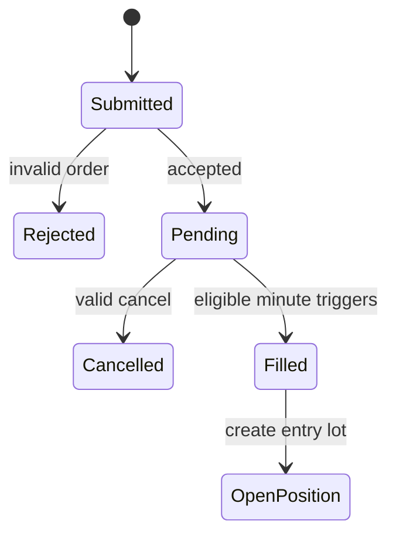

# P11 paper-order engine

Version `p11-orders-v1`. This phase is an entry-order engine and API. Chart order tickets are P13; exits, balances, fees and margin are P12; persisted sessions/journals are P14. Nothing connects to a broker.

## Quotes and units

Every session explicitly declares `input_price_basis: "bid"`. This is a caller assertion, not verified provider metadata. The initial real dataset is Dukascopy EUR/USD BID. Sell orders use bid OHLC; buy orders use bid OHLC plus a constant **simulated** spread, default 1 pip. `spread_pips` is configurable from 0–100, restricted to whole instrument ticks. It is not a historical spread estimate. All sizes are integer base-currency units from 1–100,000,000; these are validation bounds, not affordability checks.

Prices round to the nearest instrument tick, ties half up, using Decimal arithmetic. EUR/USD and GBP/USD use five decimals; USD/JPY uses three. Returned prices are decimal strings to preserve exact tick values. The accepted event records the normalized trigger price. Finite positive trigger prices up to 1,000,000 are allowed; values rounding to zero are rejected. Orders are good until cancelled; full size fills with no liquidity or partial-fill model.

Each filled entry creates a separate open position lot. Opposite directions can coexist; they do not net or close one another. No P&L or funded-account realism is implied.

## Lifecycle and ledger



Each submit emits `submitted` followed by `accepted` or `rejected`. Pending orders can emit `cancelled` or `filled`. Invalid cancellation emits `cancel_rejected` without changing state. Duplicate order IDs are rejected without altering the original order. Unknown/final orders cannot be cancelled. Event sequence numbers, order IDs and position IDs are deterministic.

Schema errors (unknown types/fields, fractional or boolean units, nonfinite prices) reject the whole request with HTTP 422. Validly shaped but invalid business orders produce rejection ledger entries. IDs must be nonempty alphanumeric/underscore/hyphen strings, at most 80 characters. Command IDs must be unique. Replaying the exact request reproduces the response; this is not a mutable submit endpoint.

## Clock and fills

The API receives a minute-aligned start, clock and chronological command list. Equal-time commands use list order. It loads prices from the immutable server dataset, never client candles. Commands outside the requested session or after the clock are rejected. Session start/clock must be within minute dataset coverage. Both P10 and P11 use the same UTC minute-close convention.

At every recorded minute, commands at or before its open are eligible. The minute must be fully revealed (close <= clock) before a fill is reported. At a boundary, fills in the minute just closed are processed **before** commands submitted at that boundary. A newly submitted order cannot fill retrospectively in that candle.

| Order | Trigger on executable quote | Fill price |
|---|---|---|
| Market buy/sell | Next observed eligible minute | Its open |
| Buy limit | Open <= limit, otherwise low <= limit | Open if marketable/gapped; otherwise limit |
| Sell limit | Open >= limit, otherwise high >= limit | Open if marketable/gapped; otherwise limit |
| Buy stop | Open >= stop, otherwise high >= stop | Open if gapped; otherwise stop |
| Sell stop | Open <= stop, otherwise low <= stop | Open if gapped; otherwise stop |

“Executable quote” here means the declared simulated bid/ask convention, not guaranteed broker execution. Buy checks use ask highs/lows, not bid highs/lows. Equality triggers. Already-marketable pending orders are accepted but wait for the next eligible observed minute.

There are no fills during missing minutes or market closures. Pending orders carry forward; the next observed open can improve a limit price or worsen a stop price. Cancellation during an empty period takes effect before the next recorded minute. Dataset end leaves outstanding orders pending with `ended: true`; no additional prices are invented.

Events use the reveal/confirmation time at minute close. `bar_open_time` identifies the source candle, `price_basis` distinguishes open versus intrabar-trigger pricing, and `intrabar_time_unknown` is true for a high/low trigger. No tick-path ordering or precise intraminute fill time is claimed. Independent entry orders can both fill in a candle; linked stop-loss/take-profit ambiguity belongs to P12.

## API

`POST /api/paper/replay` accepts at most 200 commands. Each request rebuilds the ledger from start, so seeking backward requires sending only commands through the earlier clock. There is no hidden mutable client/server session or persistence in P11. P13 must maintain an immutable ordered command list; P14 will persist it. Changing spread/history constitutes a different simulation.

Example for the locally imported P10 dataset:

```json
{
  "dataset_id": "e7a95dc184be58df2913a1cde56943ad5d30b9013977fae845af90ea0a0eff01",
  "start": 1704153600,
  "clock": 1704153720,
  "input_price_basis": "bid",
  "spread_pips": 1,
  "commands": [
    {"command_id":"submit-1","order_id":"one","time":1704153660,"action":"submit","side":"buy","kind":"market","units":1000}
  ]
}
```

Response contains version, dataset/source, clock, quote policy, orders, independent positions and sequenced events. No client-supplied fill price is accepted. Unknown dataset returns 404; invalid session/history basis returns 422. Dataset IDs and engine version support reproduction. Run `.venv/bin/python scripts/accept_paper_orders.py` to reproduce the real-minute scenario in paper-orders-p11.json. Swagger at `/docs` exposes the endpoint on a freshly started application.

The already-running port 8766 preview is intentionally preserved at the user's request. It predates P11 and does not hot-reload backend routes. P11 has been exercised in a separate temporary HTTP server; the new endpoint will be available in the preview on its next restart.
